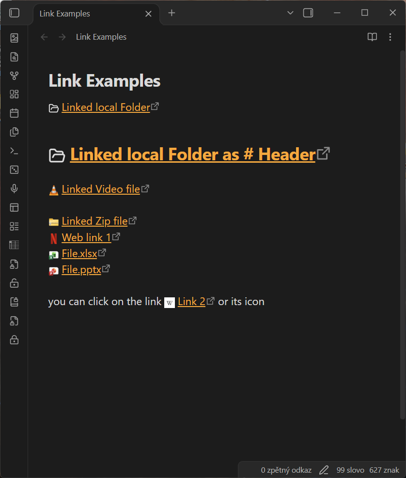

# Links with Icons

Show file, folder, and website icons next to links in your notes.



*Real examples on Windows: native file and folder icons, website icons, and icons that scale with headings.*

On Windows, Links with Icons brings the familiar application icons from File Explorer into Obsidian. A link to an Excel spreadsheet gets its Excel icon; a Word document gets its Word icon. Web links show the site's icon, just like a browser bookmark.

Use it for project notes with linked documents, reading lists with PDFs, or collections of web bookmarks. The icons help you tell those resources apart even when the links have short labels such as “Budget”, “Read next”, or “Reference”.

## What gets an icon?

- **Files:** PDFs, spreadsheets, documents, presentations, audio, video, and other attachments linked from your notes.
- **Folders:** links to folders on your computer.
- **Websites:** links to websites, with their site icons.

Works in Live Preview and Reading View with your existing links. Enable the plugin to start seeing icons; no CSS snippets or changes to your notes are needed. Ordinary Markdown notes and unresolved vault links are left alone.

Windows icons reflect your installed apps and file associations. On macOS, Linux, and mobile, local links use built-in file-type icons instead. Files outside your vault must be accessible on the device you're using.

## Make it fit your notes

Choose the icon size and folder appearance, hide icons for selected file types or websites, and decide whether to include icons in PDF exports. Click an icon to follow its link.

## Examples

| In your notes | What the icon helps you recognize |
| --- | --- |
| `[[Budget.xlsx\|Project budget]]` | A spreadsheet attached to your project |
| `[[Research paper.pdf\|Read next]]` | A PDF in your reading queue |
| `[Project files](file:///C:/Projects/Example/)` | A folder on your computer |
| `[Reference](https://www.wikipedia.org)` | A website by its familiar icon |

Local file and folder examples depend on those resources being available on your device. Unresolved vault links never receive a guessed file icon, even if their names contain periods.

## Installation

In Obsidian, open **Settings → Community plugins → Browse**, search for **Links with Icons**, then install and enable it. Icons appear beside supported links automatically.

### Manual Installation

1. Download `main.js`, `manifest.json`, and `styles.css` from the latest release.
2. Inside your Obsidian vault, create a folder named `links-with-icons` under `.obsidian/plugins/`.
3. Copy the downloaded files into that folder.
4. Go to Obsidian Settings > Community Plugins, reload the list, and enable the plugin.

## Configuration

- **Icon Size**: Set the base size of icons relative to standard 16px text.
- **Dynamic Icon Sizing**: Toggle whether icons scale up proportionally in headings.
- **Link Types**: Toggle icons specifically for wiki-links, local external links, folders, or web links.
- **Folder Icon Style**: Choose between the native OS folder icon or custom Lucide folder styles.
- **Blacklisted Extensions**: Prevent specific file types (e.g. `md`, `txt`, `canvas`) from showing icons.
- **Favicon Provider & Ignored Domains**: Customize web icon providers (Google, DuckDuckGo, Icon Horse, or Direct) and exclude specific domains.
- **Web Fallback Icon**: Select the Lucide icon to use when a favicon fails to load.
- **PDF Export**: Include or omit icons in generated PDFs.

Web favicon providers receive the domain names of links displayed in a rendered note. Select the direct provider if you prefer requests to go to each linked site instead of a centralized favicon service, or disable web favicons entirely.

## Development

```powershell
npm install
npm run check
npm run build
```

Building only writes `main.js` in the repository. To deploy into a development vault, set `OBSIDIAN_PLUGIN_DIR` to the target plugin directory and run `npm run deploy`.

Release assets published from version 1.1.0 onward include GitHub build-provenance attestations. With GitHub CLI installed, an asset can be verified using:

```powershell
gh attestation verify main.js --repo Radegast546/links-with-icons
```

## License

This project is licensed under the [GNU GPLv3 License](LICENSE).

## Credits

This plugin derives some design patterns, configurations, and core web favicon concepts from the original GPL-3.0 licensed [Link Favicons](https://github.com/joethei/obsidian-link-favicon) community plugin by [joethei](https://github.com/joethei).
